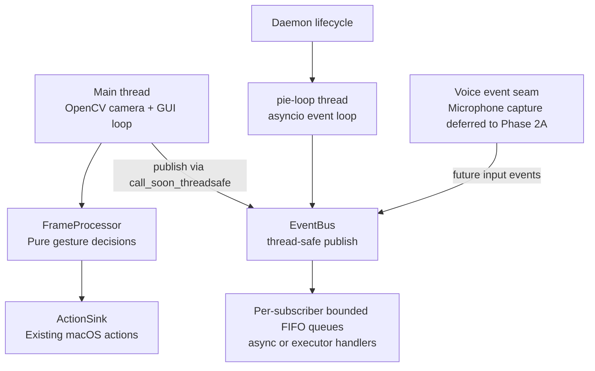

# Pie runtime architecture — Phase 1

Phase 1 adds lifecycle and observability. It does not route real-world actions through the
event bus: gesture actions still execute synchronously through the existing ActionSink on the
camera/main thread.

## Threads and ownership

- The caller/main thread owns OpenCV windows, camera reads, MediaPipe VIDEO inference, frame
  processing, and existing action execution.
- The daemon creates one dedicated thread named `pie-loop` and one asyncio event loop.
- EventBus publication is safe from any thread and schedules dispatch with
  `loop.call_soon_threadsafe`; publication does not wait for subscribers.
- Each subscriber owns a FIFO queue of at most 1000 events and an independent dispatcher task.
  Synchronous handlers run in the loop's default executor; coroutine handlers are awaited.
- Daemon starts modules in registration order and stops them in reverse order. Module stop
  execution is bounded. SIGINT/SIGTERM handlers only set the shared stop flag.
- The camera runner checks the stop flag every frame and always releases held keys, camera,
  learning data, and OpenCV windows through its existing cleanup path.

## Adding a Module

Implement a module with a stable `name`, `start(daemon)`, and `stop()`. Register it before
calling `Daemon.start()`. Startup is ordered; shutdown is reverse ordered. A startup exception
aborts startup and triggers rollback of modules that already started. Modules may publish
through `daemon.bus`; they must not perform blocking work on the asyncio loop thread.

## Event topics emitted in Phase 1

| Topic | Producer | Payload |
|---|---|---|
| `system.started` | Daemon | `version` |
| `system.stopping` | Daemon | empty object |
| `system.warning` | EventBus | `where, message` |
| `system.error` | EventBus | `where, error, detail` |
| `system.mode` | Gesture runner | `mode, game_profile` |
| `input.gesture.state` | Gesture runner | `hands, gesture, depth, armed, fps`; rate-limited by `gesture.state_hz` |
| `input.gesture.event` | Gesture runner | `name, hand, confidence`; rising-edge and 300 ms debounce |
| `input.voice.wake` | Voice event seam | `word` |
| `input.voice.listening` | Voice event seam | `active, until` |
| `input.voice.transcript` | Voice event seam | `text, final, lang` |
| `input.text.command` | TextInput | `text` |

Voice microphone capture and wake-word recognition are not implemented in this phase; the
voice controller exposes publication methods for the Phase 2A capture pipeline. No event
handler is permitted to invoke a system action in Phase 1.
